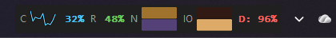
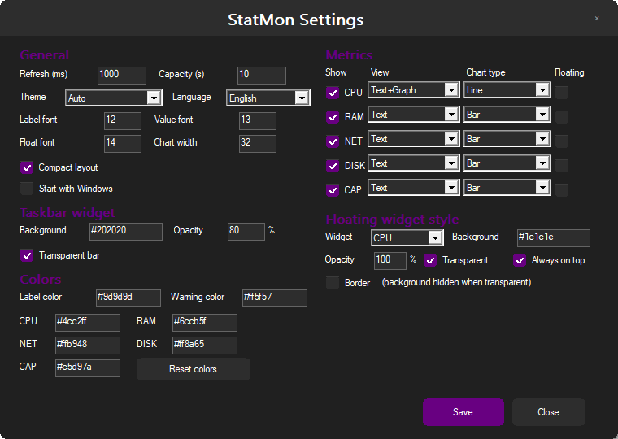

# StatMon

A tiny, native **Windows taskbar system monitor** written in Rust + Win32 (GDI).
No webview, no runtime, no background services — a single ~0.4 MB executable.





## Features

- **Lives on the taskbar** — bottom, top, left or right. Falls back to a vertical
  stack on side bars and auto-fits (compact → charts off → fewer metrics) when
  space is tight; hides itself if even one metric cannot fit.
- **Metrics** — CPU, RAM, network ↓/↑, disk activity (busy %, read, write) and
  per-drive capacity (up to three drives).
- **Per-metric display** — `Text`, `Graph`, or `Text + Graph`, with chart style
  `None / Bar / Line / Pie / LED` selectable for each metric.
- **LED charts** — one LED per row; DISK uses two rows (read / write), NET uses
  two rows (download / upload). Brightness follows the selected color and eases
  smoothly toward each new sample (no flicker, no sawtooth).
- **Hover tooltip** — a themed, click-through popup with detailed values
  (usage, used/total memory, read/write or down/up rates, per-drive usage).
- **Compact layout** — single-character labels, no separators, tight spacing.
- **Floating widgets** — split any metric into its own always-on-top window with
  per-widget background color, opacity, border, transparency and saved position;
  drag with the left mouse button.
- **Modern settings window** — frameless rounded Win32 window, custom title bar,
  owner-drawn checkboxes and buttons, live preview, system accent color.
- **Themes & colors** — auto/dark/light Windows palette, editable label, warning
  and per-metric colors.
- **Localization** — English (default), German, French, Spanish, Turkish.
- **Autostart** — optional `HKCU\...\Run` entry, toggle in settings.
- **Icon** — embedded application, window and tray icon.

Measured footprint on Windows 11: **~408 KB** executable, **~21 MB** working set,
1 Hz sampling. Charts are supersampled 4× for smooth edges; painting is
double-buffered.

## Install

1. Download `statmon-<version>-win64.zip` from
   [Releases](https://github.com/DigiLiner/statmon/releases).
2. Extract anywhere and run `statmon.exe`.
3. Right-click the widget or tray icon → **Settings** to configure.

## Unsigned builds, SmartScreen and Smart App Control

StatMon releases are **not code-signed**, so Windows may block them:

- **SmartScreen** (“Windows protected your PC”): click **More info → Run anyway**.
  If the file came from a ZIP, you can also right-click `statmon.exe` →
  Properties → **Unblock**.
- **Smart App Control (SAC)** (Windows 11): SAC has **no per-app allow list** and
  no “Run anyway” button. Unsigned or unknown publishers are blocked silently.
  Options:
  1. **Turn SAC off** — Settings → Privacy & security → Windows Security →
     App & browser control → Smart App Control → **Off**. Warning: once turned
     off, SAC cannot be re-enabled without reinstalling Windows.
  2. **Use a signed build** — see [docs/SIGNING.md](docs/SIGNING.md). The release
     workflow signs the executable automatically when certificate secrets are
     configured.
  3. Use a Windows 10 PC or a Windows 11 PC without SAC.

Do not use “security bypass” tricks; a valid Authenticode signature (or SAC
disabled) is the only supported path. Signing is done with `signtool` after the
build — see the workflow and documentation.

## Usage

- **Right-click** the bar or a floating widget for a context menu with
  per-metric settings, display mode, chart type, floating widgets, compact mode
  and autostart.
- **Hover** a tile to see the details popup.
- Settings are stored in `%APPDATA%\statmon\config.json`.

Notable config keys:

| Key | Meaning |
| --- | --- |
| `refresh_ms` | Sampling interval (default 1000) |
| `compact` | Compact layout |
| `bar_transparent`, `bar_bg`, `bar_opacity` | Taskbar widget surface |
| `graphs.*` | Chart type per metric (`none`, `bar`, `line`, `pie`, `led`) |
| `views.*` | Display mode per metric (`text`, `graph`, `both`) |
| `colors.*` | Overrides: `label`, `warn`, `cpu`, `ram`, `net`, `net_up`, `disk`, `disk_up`, `cap` |
| `language` | `en`, `de`, `fr`, `es`, `tr` |
| `floats.*` | Floating widget `on`, `x`, `y`, `bg`, `opacity`, `border`, `border_color`, `topmost` |

## Build

Requirements: Windows 10/11, Rust (MSVC toolchain). The Windows SDK (`rc.exe`)
is used by `build.rs` to embed the icon; without it the build still works and
falls back to a default icon.

```powershell
cargo build --release
# -> target\release\statmon.exe
```

Developer helper (prints one metrics sample):

```powershell
cargo run -- --once
```

## Releases

Pushing a tag builds the zip on GitHub Actions and attaches it to a release:

```powershell
git tag v0.1.0
git push origin v0.1.0
```

Manual upload with the GitHub CLI:

```powershell
gh release create v0.1.0 dist/statmon-0.1.0-win64.zip `
  --title "StatMon 0.1.0" --generate-notes
```

To build the same archive locally:

```powershell
powershell -ExecutionPolicy Bypass -File scripts\release.ps1
# publish directly (requires gh + gh auth login):
powershell -ExecutionPolicy Bypass -File scripts\release.ps1 -Publish
```

## Limitations

- Windows 11 has no public taskbar-extension API; StatMon uses a topmost overlay
  window and follows the shell's taskbar geometry. Moving the taskbar to the
  top/left/right requires Windows 10 or a third-party shell tweak.
- Only the primary taskbar (`Shell_TrayWnd`) is followed; secondary-monitor
  taskbars are not supported.
- Temperature/GPU sensors would require a signed kernel driver and are
  intentionally out of scope.
- The executable is unsigned.

## License

MIT — see [LICENSE](LICENSE).

---

## Türkçe

**StatMon**, Windows görev çubuğunda çalışan küçük ve hızlı bir sistem izleme
widget'ıdır (Rust + Win32, webview yok).

- CPU, RAM, ağ ↓/↑, disk doluluk ve disk G/Ç (meşgul %, okuma, yazma) gösterir.
- Her metrik için Metin / Grafik / Metin+Grafik ve Bar / Çizgi / Pasta / **LED**
  grafik türü seçilebilir. Disk LED'i okuma/yazma, ağ LED'i indirme/yükleme için
  iki satırlıdır; parlaklık yumuşak geçiş yapar.
- Görev çubuğu üst/alt/sol/sağ kenarda desteklenir; yer kalmazsa otomatik
  sıkışır, gerekirse gizlenir.
- Metrikler ayrı, şeffaf / opaklıklı / kenarlıklı, üstte kalan yüzen pencerelere
  alınabilir; konumlar saklanır.
- Üzerine gelince ayrıntılı değerleri gösteren tema uyumlu bir açılır pencere
  çıkar.
- Ayarlar: modern çerçevesiz pencere, koyu tema, renk düzenleme, dil
  (EN/DE/FR/ES/TR), Windows açılışında başlatma.
- Kurulum: Releases'tan zip'i indirip `statmon.exe` çalıştırın. Derleme:
  `cargo build --release`. Lisans: MIT.

**İmzasız exe uyarısı:** StatMon imzalı değildir. SmartScreen çıkarsa
“Ek bilgi → Yine de çalıştır” deyin. **Smart App Control (SAC)** açıksa exe
sessizce engellenir; SAC'ta uygulama izin listesi yoktur. Ya SAC'ı kapatın
(Ayarlar → Gizlilik ve güvenlik → Windows Güvenliği → Uygulama ve tarayıcı
denetimi → Akıllı Uygulama Denetimi → Kapalı; geri açmak Windows'u yeniden
kurmadan mümkün değildir) ya imzalı bir sürüm kullanın
(bkz. [docs/SIGNING.md](docs/SIGNING.md)) ya da SAC'sız bir PC kullanın.
